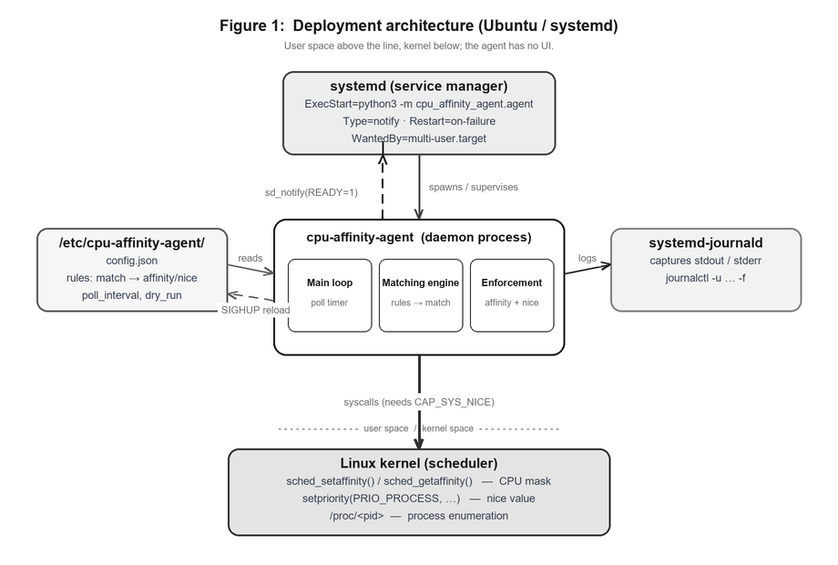
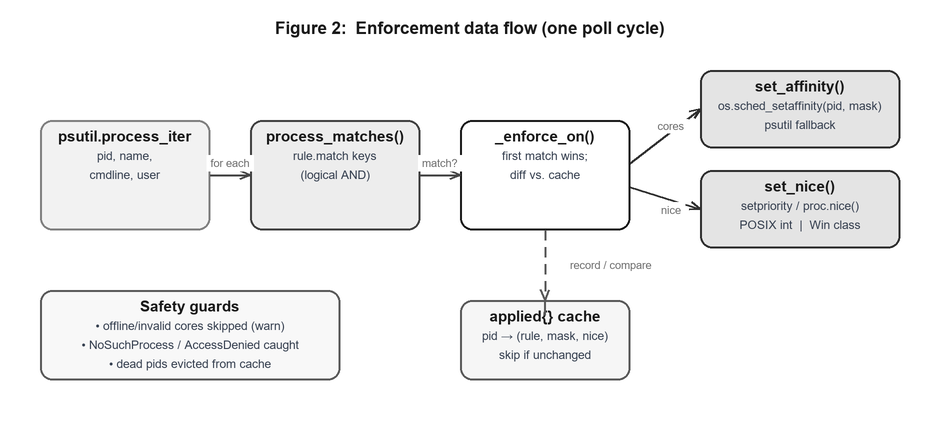
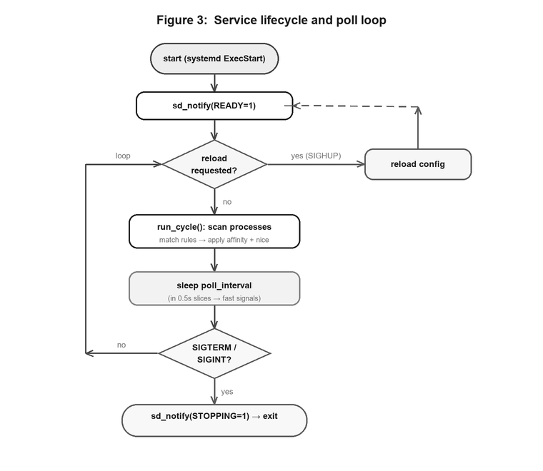

# CPU Affinity & Priority Agent

A **headless (no-UI) agent** that runs as a **systemd service** on Ubuntu Linux.
It continuously enforces, for processes you select by rule:

- **CPU affinity** — the set of logical CPU cores a process is allowed to run on.
- **Scheduling priority** — the POSIX **nice** value (`-20` highest … `19` lowest).

It is one of three agents in the project; this is **Agent #3: CPU Affinity & Priority**.

---

## Architecture

**Figure 1 — Deployment architecture.** `systemd` supervises the agent, the
config file feeds it rules, `journald` collects its logs, and the kernel does
the actual scheduling work. Everything above the dividing line is user space.



**Figure 2 — Enforcement data flow (one poll cycle).** Each cycle scans every
process, tests it against the rules, and applies CPU affinity and nice to the
first rule that matches, skipping anything already in the desired state.



**Figure 3 — Service lifecycle and poll loop.** Readiness notification to
systemd, the scan-and-sleep loop, `SIGHUP` config reload, and a clean
`SIGTERM`/`SIGINT` shutdown.



---

## 1. Approach — "agent as a service, no UI"

The agent is a long-running **daemon**. It has no GUI/CLI interaction during
normal operation: it reads a JSON config, loops on a timer, applies rules to
matching processes, and logs to **stdout/stderr**, which **systemd-journald**
captures. Lifecycle is owned by **systemd**:

| Concern            | How it is handled                                              |
|--------------------|----------------------------------------------------------------|
| Start/stop/enable  | `systemctl {start,stop,enable} cpu-affinity-agent`             |
| Boot persistence   | `WantedBy=multi-user.target` in the unit file                  |
| Auto-restart       | `Restart=on-failure`                                           |
| Readiness          | `Type=notify` + `sd_notify(READY=1)` (see `_notify_systemd`)   |
| Reload config      | `systemctl reload …` → `SIGHUP` → re-reads config, no restart  |
| Graceful shutdown  | `SIGTERM`/`SIGINT` → finishes the cycle and exits              |
| Logs               | `journalctl -u cpu-affinity-agent -f`                          |
| Least privilege    | Hardening directives + `CAP_SYS_NICE` instead of full root     |

### Why this design
Affinity/priority are **per-process kernel attributes**, not one-shot settings:
new matching processes appear over time (e.g. every `rsync` backup, every
compiler invocation), so an agent that **polls and re-applies** is the right
model rather than a script you run once.

---

## 2. Which C headers (the native/kernel view)

The underlying mechanism is a small set of POSIX/Linux syscalls. If you wrote
this agent in **C** on Ubuntu, these are the headers and calls:

| Capability                | C header            | Key functions / macros                                     |
|---------------------------|---------------------|-------------------------------------------------------------|
| CPU affinity              | `<sched.h>`         | `sched_setaffinity()`, `sched_getaffinity()`, `cpu_set_t`, `CPU_ZERO`, `CPU_SET`, `CPU_ISSET` |
| Scheduling priority (nice)| `<sys/resource.h>`  | `setpriority()`, `getpriority()` with `PRIO_PROCESS`        |
| nice (simple form)        | `<unistd.h>`        | `nice()`                                                   |
| Realtime scheduling policy| `<sched.h>`         | `sched_setscheduler()`, `SCHED_FIFO`, `SCHED_RR`, `SCHED_OTHER`, `struct sched_param` |
| Process/pid, sleeping     | `<unistd.h>`        | `getpid()`, `sleep()`, `usleep()`                          |
| Enumerate processes       | `<dirent.h>`, `<sys/types.h>` | read `/proc/<pid>/` (`opendir`, `readdir`)        |
| Signals (TERM/HUP)        | `<signal.h>`        | `sigaction()`, `SIGTERM`, `SIGHUP`                         |
| systemd notify (optional) | `<systemd/sd-daemon.h>` | `sd_notify()` (link with `-lsystemd`, pkg `libsystemd-dev`) |
| Capabilities (optional)   | `<sys/capability.h>`| `CAP_SYS_NICE` (pkg `libcap-dev`)                          |

> Lowering a nice value below 0, or changing another user's process, requires
> **`CAP_SYS_NICE`** (or root). This is a kernel rule, identical for the C and
> Python versions.

This project implements the agent in **Python** (faster to build, easy to test,
no compilation on target). Python's standard library wraps exactly these
syscalls, so the behaviour is the same:

- `os.sched_setaffinity()` / `os.sched_getaffinity()` → `sched_setaffinity(2)`
- `os.setpriority()` (and `psutil.Process.nice()`) → `setpriority(2)`
- `/proc` enumeration → provided by `psutil.process_iter()`

The agent prefers the native `os.sched_*` calls on Linux (see `set_affinity`)
and falls back to `psutil` elsewhere.

---

## 3. Which Python packages (Ubuntu)

| Package              | Purpose                                                        | Install on Ubuntu                      |
|----------------------|----------------------------------------------------------------|----------------------------------------|
| **python3**          | Runtime (3.8+)                                                 | `sudo apt install python3`             |
| **python3-psutil**   | Cross-platform process discovery + affinity/nice helpers       | `sudo apt install python3-psutil`      |
| *(stdlib)* `os`, `signal`, `socket`, `json`, `logging`, `argparse` | syscalls, signals, sd_notify, config, logging, CLI | ships with Python |

Everything else is Python's **standard library** — no pip needed if you use the
distro `python3-psutil`. `socket` is used only to speak the `sd_notify`
protocol to systemd's `NOTIFY_SOCKET`; no network is used (the unit restricts
`RestrictAddressFamilies=AF_UNIX`).

> Prefer the apt package `python3-psutil` over `pip` for a system service, so it
> is tracked by the package manager and survives Python upgrades cleanly.

---

## 4. Install & run (Ubuntu)

```bash
sudo ./install.sh
systemctl status cpu-affinity-agent
journalctl -u cpu-affinity-agent -f
```

`install.sh` installs `python3-psutil`, copies the package to
`/opt/cpu-affinity-agent`, the config to `/etc/cpu-affinity-agent/config.json`,
and the unit to `/etc/systemd/system/`, then enables and starts the service.

Edit the config and apply without downtime:

```bash
sudoedit /etc/cpu-affinity-agent/config.json
systemctl reload cpu-affinity-agent
```

---

## 5. Configuration

`/etc/cpu-affinity-agent/config.json`:

```json
{
  "poll_interval_seconds": 5,
  "dry_run": false,
  "rules": [
    { "name": "pin-nginx",     "match": { "name": "nginx" },            "cpu_affinity": [0, 1], "nice": -5 },
    { "name": "throttle-rsync","match": { "cmdline_contains": "rsync" },"cpu_affinity": [2, 3], "nice": 15 },
    { "name": "slow-compilers","match": { "name_regex": "^(gcc|cc1|ld)$" },                     "nice": 10 }
  ]
}
```

**Match keys** (all present keys must match — logical AND):

| Key                | Meaning                                          |
|--------------------|--------------------------------------------------|
| `name`             | exact process name, case-insensitive             |
| `name_regex`       | Python regex tested against the process name     |
| `cmdline_contains` | substring of the full command line               |
| `pid`              | exact process id                                 |
| `user`             | owning username                                  |

**Actions** (at least one required): `cpu_affinity` (list of core numbers),
`nice` (integer `-20..19`). First matching rule wins. Offline/invalid cores are
skipped with a warning. Set `"dry_run": true` to log intended actions without
changing anything.

---

## 6. Testing

```bash
# validate config only
python3 -m cpu_affinity_agent.agent --config config/agent.json --check

# single enforcement cycle then exit (great with dry_run)
python3 -m cpu_affinity_agent.agent --config config/agent.json --once

# full test suite (15 tests: config, matching engine, dry-run, real affinity, end-to-end)
python3 -m pytest tests/ -v          # runs test_engine.py + test_agent.py
```

The suite includes an **integration test** that spawns a real child process,
pins it with `sched_setaffinity`, and reads the affinity back. On a multi-core
Linux host you can watch a live service at work with:

```bash
# start a load process, let the agent pin it, then confirm:
taskset -cp <pid>          # shows current affinity mask
cat /proc/<pid>/stat | awk '{print "nice:", $19}'
```

---

## 7. Files

The project is split into two parts with no shared files, so the two authors
can work and commit independently (see [CONTRIBUTORS.md](CONTRIBUTORS.md)).

```
Part A - Policy engine & configuration   (Ankit Ray, 24BCE0497)
  cpu_affinity_agent/config.py         # Rule, Config: load + validate JSON
  cpu_affinity_agent/matching.py       # process_matches: the matching engine
  cpu_affinity_agent/enforcement.py    # set_affinity / set_nice (os.sched_*)
  config/agent.json                    # sample rules
  tests/test_engine.py                 # engine unit + affinity integration tests

Part B - Daemon, service & packaging    (Naman Jain, 24BKT0140)
  cpu_affinity_agent/__init__.py       # package, lazy re-exports
  cpu_affinity_agent/agent.py          # Agent daemon: poll loop, signals, CLI
  systemd/cpu-affinity-agent.service   # systemd unit (Type=notify, hardened)
  install.sh                           # Ubuntu installer
  requirements.txt                     # psutil
  tests/test_agent.py                  # daemon / dry-run / end-to-end tests
  README.md                            # this file
```

Part B imports Part A; neither part edits the other's files.
